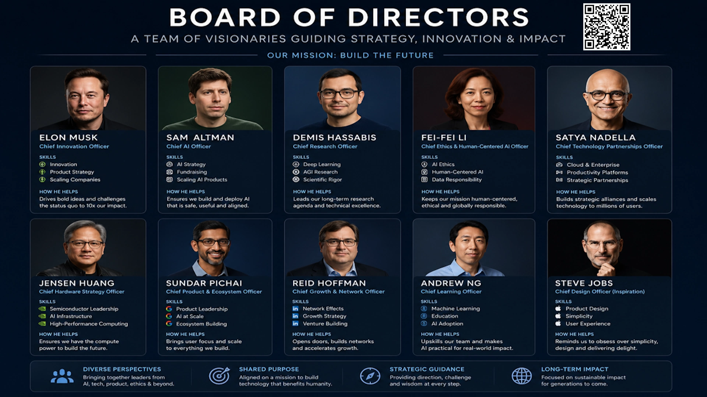

# Board of Directors

  

> **Important Notice:** This repository is an experimental collection of Claude Code agents and skills for multi-perspective strategic decision-making. The director profiles are archetypes inspired by publicly known topics, working methods, and leadership principles of the named individuals. They **do not simulate private views and do not speak on anyone's behalf**. All outputs are analytical work aids. This framework is **not** a substitute for professional management consulting, legal advice, or financial advice. Users bear sole responsibility for how they use or act upon any output.

## How to Use

There is no install step and no marketplace. Clone the repository and open the folder directly in whichever tool you use — each one discovers its own native files immediately:

1. Clone: `git clone https://github.com/markusbegerow/board-of-directors`
2. Open the cloned folder as your project:
   - **Claude Code** — `CLAUDE.md` loads automatically; `.claude/agents/` (10 subagents) and `.claude/skills/` (17 skills) are discovered as project agents/skills.
   - **Codex CLI** — `AGENTS.md` loads automatically; `.agents/skills/` is discovered as the project skill catalog.
   - **OpenCode** — `AGENTS.md` loads automatically; it discovers `.claude/skills/` and `.agents/skills/` directly, plus the native `.opencode/agent/` subagents and `.opencode/command/` slash commands.
3. Invoke the board:
   - Claude Code: `/board [your decision question]`, or natural language.
   - OpenCode: `/board [your decision question]` (via `.opencode/command/board.md`), or natural language.
   - Codex CLI: describe the task in natural language — the `board` skill auto-loads. There is no slash-command syntax in Codex CLI.

Or ask a specific director — Claude Code: "Use the elon-musk agent and evaluate: [question]"; OpenCode: `/elon-skills [question]` or the `elon-musk` subagent; Codex CLI: reference the `elon-skills` skill in natural language.

**Honest per-tool status** — only Claude Code's discovery has been structurally verified in this repository's own development session (the subagents and skills showed up as available tools once the files existed). OpenCode and Codex CLI are not installed in that environment, so their behavior above is the intended, structurally-correct integration per each tool's own documented discovery paths, not a live-tested confirmation — please verify locally (`opencode debug skill`, `opencode agent list`, or a live Codex CLI chat) and open an issue if something doesn't load.

See `INSTALLATION.md` for a step-by-step guide.

---

## What Is This?

This repository provides 10 director agent profiles and 7 shared methodology skills that support structured multi-perspective decision-making — usable directly in Claude Code, Codex CLI, and OpenCode. No plugin system, no marketplace: clone the repo, open it, use it.

| Location | Count | Tool | Purpose |
|---|---|---|---|
| `.claude/agents/<name>.md` | 10 | Claude Code | Task-spawnable director subagents |
| `.opencode/agent/<name>.md` | 10 | OpenCode | Native director subagents |
| `.claude/skills/<name>/SKILL.md` | 17 | Claude Code, OpenCode | Orchestrator + 6 methodology skills + 10 persona shortcuts (auto-trigger) |
| `.agents/skills/<name>/SKILL.md` | 17 | Codex CLI, OpenCode | Hand-mirrored copy of `.claude/skills/` |
| `.opencode/command/<name>.md` | 17 | OpenCode | Explicit `/command-name` wrappers over the same skills |

`.claude/agents/` and `.claude/skills/` are the two files you hand-edit for any change; the rest are hand-mirrored copies/adaptations kept in sync manually (small enough at 44 files total — see `CONTRIBUTING.md`).

## The Directors

| Agent | Director | Primary Perspective |
|---|---|---|
| `elon-musk` | Elon Musk | First principles, radical innovation, 10x scaling |
| `sam-altman` | Sam Altman | AI strategy, platform thinking, capital, ecosystem |
| `demis-hassabis` | Demis Hassabis | Research, hypotheses, evidence, scientific rigor |
| `feifei-li` | Fei-Fei Li | Human-centered AI, ethics, fairness, governance |
| `satya-nadella` | Satya Nadella | Enterprise, cloud, partnerships, transformation |
| `jensen-huang` | Jensen Huang | Hardware, compute, infrastructure, TCO |
| `sundar-pichai` | Sundar Pichai | Product, user value, ecosystem, scale |
| `reid-hoffman` | Reid Hoffman | Growth, network effects, venture, relationships |
| `andrew-ng` | Andrew Ng | Applied AI, data quality, pilots, learning |
| `steve-jobs` | Steve Jobs | Product vision, simplicity, UX, storytelling |

## Quick Start

1. Read `QUICKSTART.md` (2 minutes).
2. Open this repository in Claude Code as the project directory.
3. Run `/board [your decision question]` — the orchestrator selects the right directors automatically.
4. Or invoke a single director: use the `elon-musk` agent and evaluate: [question].

See `SKILLS.md` for a flat index of all skills, and `INSTALLATION.md` for a beginner-friendly setup guide.

## Ruleset

All agents and skills follow the ruleset in `AGENTS.md` (master, read by Codex CLI and OpenCode) — `CLAUDE.md` just imports it (`@AGENTS.md`) plus a short Claude Code-specific section. Core reference documents:

- `references/methodik-board.md` — 5-step board decision methodology.
- `references/archetype-guidelines.md` — Rules for how archetypes are defined and used responsibly.
- `references/source-hygiene.md` — How to separate speculation from evidence in outputs.

## Director Selection Guide

| Decision type | Directors to convene |
|---|---|
| New business model | elon-musk + reid-hoffman + sundar-pichai |
| AI product | sam-altman + andrew-ng + feifei-li + sundar-pichai |
| Research or technology decision | demis-hassabis + jensen-huang + andrew-ng |
| Enterprise transformation | satya-nadella + sundar-pichai + feifei-li |
| Pitch or product presentation | steve-jobs + reid-hoffman + sam-altman |
| Infrastructure decision | jensen-huang + satya-nadella + demis-hassabis |
| Governance and Responsible AI | feifei-li + demis-hassabis + satya-nadella |

## License

Apache-2.0 OR MIT — see `LICENSE`.

## Further Documents

- `CONTRIBUTING.md` — Contribution guidelines and PR checklist.
- `CODE_OF_CONDUCT.md` — Community code of conduct.
- `CHANGELOG.md` — Version history.
- `EVAL_RESULTS.md` — Quality evaluation status.
- `SKILLS.md` — Flat index of all skills and agents.

## Contact

- [Markus Begerow on LinkedIn](https://linkedin.com/in/markusbegerow)
- [GitHub](https://github.com/markusbegerow)
